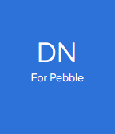
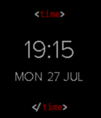

<!-- Generated by scripts/update_app_directory.py: do not edit by hand -->
[← All Pebble Developers](../developers.md)

# Ire

*1 watchface and 1 app · Last updated 2026-10-12 · [About these lists](../about-app-lists.md)*

Links: [Pebble App Store](https://apps.repebble.com/apps/dev/ire_55b4a9558fde01307d00002e) · [GitHub (ireade)](https://github.com/ireade)

<button type="button" data-filter="all" aria-pressed="true">All 2</button><button type="button" data-filter="watchface" aria-pressed="false">Watchfaces 1</button><button type="button" data-filter="watchapp" aria-pressed="false">Apps 1</button>

<label class="dev-sort">Sort by <select><option value="updated">Recently updated</option><option value="released">Newest release</option><option value="title">A–Z</option></select></label>

<h2 class="app-name" id="app-55b75efd3d39bb179a00003d"><a href="https://apps.repebble.com/55b75efd3d39bb179a00003d">DN for Pebble</a> v2</h2>
<a class="app-source" href="https://github.com/ireade/dn-for-pebble" title="Source code" data-search-exclude>View source</a>

App

No licence Released 2015-07-28 Updated 2015-08-21

Runs on: Time 2, Pebble 2 Duo, Pebble 2, Time, Classic

The (unofficial) Designer News App for Pebble. Choose between Top Stories, Recent Stories, and Discussions. View the key information from each story.

<h2 class="app-name" id="app-55b6759e1ad0f44f2d000070"><a href="https://apps.repebble.com/55b6759e1ad0f44f2d000070">HTML5 Time</a> v1.0</h2>
<a class="app-source" href="https://github.com/ireade/html5-time" title="Source code" data-search-exclude>View source</a>

Watchface

No licence Released 2015-07-27 Updated 2015-07-27

Runs on: Time 2, Pebble 2 Duo, Pebble 2, Time, Classic

A watchface inspired by HTML5

