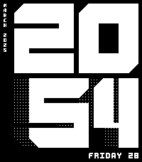
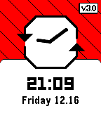

<!-- Generated by scripts/update_app_directory.py: do not edit by hand -->
[← All Pebble Developers](../developers.md)

# irek

*4 watchfaces · Last updated 2026-10-12 · [About these lists](../about-app-lists.md)*

Links: [Rebble App Store](https://apps.rebble.io/en_US/developer/636763090587050008d091aa/1) · [GitHub (ir33k)](https://github.com/ir33k) · [Website (irek.gabr.pl)](http://irek.gabr.pl/)

<button type="button" data-filter="all" aria-pressed="true">All 4</button><button type="button" data-filter="watchface" aria-pressed="false">Watchfaces 4</button><button type="button" data-filter="watchapp" aria-pressed="false" disabled>Apps 0</button>

<label class="dev-sort">Sort by <select><option value="updated">Recently updated</option><option value="released">Newest release</option><option value="title">A–Z</option></select></label>

<h2 class="app-name" id="app-67c751c6d2acb30009a3c812"><a href="https://apps.rebble.io/en_US/application/67c751c6d2acb30009a3c812">BRUTAL</a> v5.4</h2>
<a class="app-source" href="https://github.com/ir33k/brutal" title="Source code" data-search-exclude>View source</a>

Watchface · <a href="https://forum.rebble.io/t/275" title="Discuss this app on the Rebble forum" data-search-exclude>Forum thread</a>

GPL-2.0 Released 2025-03-04 Updated 2026-08-27 Rebble App Store

Runs on: Round 2, Time 2, Pebble 2 Duo, Pebble 2, Time Round, Time, Classic

Basic watchface with big time made with custom fonts resembling huge buildings of brutalist architecture. Created during Rebble Hackathon #002. - Big digital time 12h/24h - Customizable text lines…

<h2 class="app-name" id="app-69514fb711ece50009816c83"><a href="https://apps.rebble.io/en_US/application/69514fb711ece50009816c83">Jealous</a> v1.0</h2>
<a class="app-source" href="https://github.com/ir33k/jealous" title="Source code" data-search-exclude>View source</a>

Watchface · <a href="https://forum.rebble.io/t/364" title="Discuss this app on the Rebble forum" data-search-exclude>Forum thread</a>

GPL-2.0 Released 2025-12-28 Updated 2025-12-28 Rebble App Store

Runs on: Time 2, Pebble 2 Duo, Pebble 2, Time, Classic

My take on watchface with tall font and weather. - Digital time 24/12h with optional seconds - Up to 8 lines of text on left and right side with date, time, health, icons, weather and more - Quick…

<h2 class="app-name" id="app-69469023828bd90009075f2d"><a href="https://apps.rebble.io/en_US/application/69469023828bd90009075f2d">Naive</a> v1.1</h2>
<a class="app-source" href="https://github.com/ir33k/naive" title="Source code" data-search-exclude>View source</a>

Watchface · <a href="https://forum.rebble.io/t/317" title="Discuss this app on the Rebble forum" data-search-exclude>Forum thread</a>

GPL-2.0 Released 2025-12-20 Updated 2025-12-20 Rebble App Store

Runs on: Time 2, Pebble 2 Duo, Pebble 2, Time, Classic

Big abstract looking numbers with rounded features and 4 lines of customizable text. In comparison to Brutal (my previous watchface) this tries to take itself less seriously, look artistic and…

<h2 class="app-name" id="app-637aa98bfdf3e30009f6398f"><a href="https://apps.rebble.io/en_US/application/637aa98bfdf3e30009f6398f">pRebble</a> v3.1</h2>
<a class="app-source" href="https://github.com/ir33k/prebble" title="Source code" data-search-exclude>View source</a>

Watchface

No licence Released 2022-11-20 Updated 2025-03-03 Rebble App Store

Runs on: Round 2, Time 2, Pebble 2 Duo, Pebble 2, Time Round, Time, Classic

Watchface inspired by Rebble logo and Pebble UI design. Created during Rebble Hackathon #001. - Digital and analog - Time 24h/12h - Date - Compatible with Quick View - Quick animation after each…

