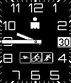

<!-- Generated by scripts/update_app_directory.py: do not edit by hand -->
[← All Pebble Developers](../developers.md)

# Irongeek

*1 watchface · Last updated 2026-10-11 · [About these lists](../about-app-lists.md)*

Links: [Pebble App Store](https://apps.repebble.com/apps/dev/irongeek_552b679ae9408f68ac0000b7) · [GitHub (mriscott)](https://github.com/mriscott)

<h2 class="app-name" id="app-5633537887f22705b9000056"><a href="https://apps.repebble.com/5633537887f22705b9000056">ModernTri</a> v1.2</h2>
<a class="app-source" href="https://github.com/mriscott/ModernTri" title="Source code" data-search-exclude>View source</a>

Watchface

Released 2015-10-30 Updated 2016-02-05

Runs on: Round 2, Time 2, Pebble 2 Duo, Pebble 2, Time Round, Time, Classic

Clean, triathlon-themed watchface, based on the well-known Modern face

