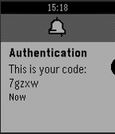

<!-- Generated by scripts/update_app_directory.py: do not edit by hand -->
[← All Pebble Developers](../developers.md)

# Isaiah Kasten

*1 app · Last updated 2026-10-12 · [About these lists](../about-app-lists.md)*

Links: [Rebble App Store](https://apps.rebble.io/en_US/developer/559af33f071c858fbb000062/1)

<h2 class="app-name" id="app-58795dba5de85036d5000178"><a href="https://apps.rebble.io/en_US/application/58795dba5de85036d5000178">Smart things Remote</a> v1.1</h2>
<a class="app-source" href="https://cloudpebble.net/ide/project/388885" title="Source code" data-search-exclude>View source</a>

App

Released 2017-01-13 Updated 2017-01-13 Rebble App Store

Runs on: Time 2, Pebble 2 Duo, Pebble 2, Time, Classic

Remote

