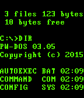
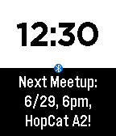
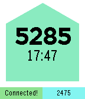
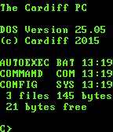

<!-- Generated by scripts/update_app_directory.py: do not edit by hand -->
[← All Pebble Developers](../developers.md)

# Ish Ot Jr.

*4 watchfaces · Last updated 2026-10-12 · [About these lists](../about-app-lists.md)*

Links: [Pebble App Store](https://apps.repebble.com/apps/dev/ish-ot-jr_52f1ada1f216769cb90007ca) · [GitHub (ishotjr)](https://github.com/ishotjr) · [GitHub (PebbleA2)](https://github.com/PebbleA2) · [GitHub (HackDads)](https://github.com/HackDads) · [Website (ishotjr.com)](http://ishotjr.com/tag/pw-dos/)

<button type="button" data-filter="all" aria-pressed="true">All 4</button><button type="button" data-filter="watchface" aria-pressed="false">Watchfaces 4</button><button type="button" data-filter="watchapp" aria-pressed="false" disabled>Apps 0</button>

<label class="dev-sort">Sort by <select><option value="updated">Recently updated</option><option value="released">Newest release</option><option value="title">A–Z</option></select></label>

<h2 class="app-name" id="app-550f2f3a46cb79c9bc000044"><a href="https://apps.repebble.com/550f2f3a46cb79c9bc000044">PW-DOS Command Line Watchface</a> v2.1</h2>
<a class="app-source" href="https://github.com/ishotjr/pw-dos" title="Source code" data-search-exclude>View source</a>

Watchface

No licence Released 2015-03-22 Updated 2016-11-27

Runs on: Time 2, Pebble 2 Duo, Pebble 2, Time, Classic

PW-DOS is a silly watchface for that small niche of individuals who enjoy modern wearable devices yet pine for the days of staring at a blinking command prompt. Day and month are reflected in…

<h2 class="app-name" id="app-575b9310beeadda36e000018"><a href="https://apps.repebble.com/575b9310beeadda36e000018">Ann Arbor Meetup Demo Watchface</a> v0.1</h2>
<a class="app-source" href="https://github.com/PebbleA2/PebbleA2" title="Source code" data-search-exclude>View source</a>

Watchface

No licence Released 2016-06-11 Updated 2016-06-11

Runs on: Round 2, Time 2, Pebble 2 Duo, Pebble 2, Time Round, Time, Classic

This is a simple demo watchface for the PebbleA2 Meetup in Ann Arbor, Michigan. Unless you&#x27;re an attendee, or interested in learning how to make a basic watchface, it&#x27;s probably not of any…

<h2 class="app-name" id="app-55ea94ef2ad21a16b40000a1"><a href="https://apps.repebble.com/55ea94ef2ad21a16b40000a1">Hack Dads Altimeter Watchface (PRB Hackathon)</a> v1.0</h2>
<a class="app-source" href="https://github.com/HackDads/Pebble-Altimeter-Watchface" title="Source code" data-search-exclude>View source</a>

Watchface

No licence Released 2015-09-05 Updated 2015-09-06

Runs on: Time 2, Time

Hack Dads came to Pebble Rocks Boulder with the intention of making a fully functional Pebble Smartstrap that runs without the need for an external power supply. We have achieved this goal with…

<h2 class="app-name" id="app-5563583a32fe79e321000090"><a href="https://apps.repebble.com/5563583a32fe79e321000090">Cardiff Giant Simulator (inspired by AMC&#x27;s Halt and Catch Fire AKA HCF)</a> v1.8</h2>
<a class="app-source" href="https://github.com/ishotjr/pw-dos" title="Source code" data-search-exclude>View source</a>

Watchface

No licence Released 2015-05-25 Updated 2015-05-29

Runs on: Time 2, Pebble 2 Duo, Pebble 2, Time, Classic

The Cardiff Giant Simulator is a remix of the PW-DOS Command Line Watchface, in celebration of Halt and Catch Fire Season 2, premiering on May 31st. Unfortunately we had to reduce RAM to save…

