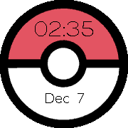
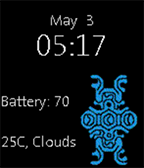

<!-- Generated by scripts/update_app_directory.py: do not edit by hand -->
[← All Pebble Developers](../developers.md)

# Ishan Taparia

*2 watchfaces · Last updated 2026-10-11 · [About these lists](../about-app-lists.md)*

Links: [Pebble App Store](https://apps.repebble.com/apps/dev/ishan-taparia_547eb4213688a2a318000167) · [GitHub (ITaparia)](https://github.com/ITaparia) · [Website (itaparia.github.io)](http://itaparia.github.io/)

<button type="button" data-filter="all" aria-pressed="true">All 2</button><button type="button" data-filter="watchface" aria-pressed="false">Watchfaces 2</button><button type="button" data-filter="watchapp" aria-pressed="false" disabled>Apps 0</button>

<label class="dev-sort">Sort by <select><option value="updated">Recently updated</option><option value="released">Newest release</option><option value="title">A–Z</option></select></label>

<h2 class="app-name" id="app-5665ee1d2369a71e6c00007a"><a href="https://apps.repebble.com/5665ee1d2369a71e6c00007a">Pokéball WatchFace</a> v1.0</h2>
<a class="app-source" href="https://github.com/ITaparia/Pebble-Development/tree/Pokeball_Watchface" title="Source code" data-search-exclude>View source</a>

Watchface

No licence Released 2015-12-07 Updated 2015-12-09

Runs on: Round 2, Time Round

This is a watch face designed for Pokémon fans for all ages! Features include: *Time *Date *Full color shoutout to: Breity, Keshav, Justin, and Piyush

<h2 class="app-name" id="app-5546a140f17601c9380000d5"><a href="https://apps.repebble.com/5546a140f17601c9380000d5">Shadow of the Colossus Watchface</a> v1.0</h2>
<a class="app-source" href="https://github.com/ITaparia/Pebble-Development/tree/SotC_WatchFace" title="Source code" data-search-exclude>View source</a>

Watchface

No licence Released 2015-05-03 Updated 2015-05-03

Runs on: Time 2, Pebble 2 Duo, Pebble 2, Time, Classic

This is a very simple watch face, made for the fans of the popular video game: Shadow of the Colossus! *Features* - Simple Digital Clock - Date Display (Month/Day) - Battery Level Indicator …

