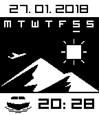

<!-- Generated by scripts/update_app_directory.py: do not edit by hand -->
[← All Pebble Developers](../developers.md)

# itmitica

*5 watchfaces · Last updated 2026-10-12 · [About these lists](../about-app-lists.md)*

Links: [Rebble App Store](https://apps.rebble.io/en_US/developer/5721f6ed0676425a62000009/1) · [GitHub (itmitica)](https://github.com/itmitica)

<button type="button" data-filter="all" aria-pressed="true">All 5</button><button type="button" data-filter="watchface" aria-pressed="false">Watchfaces 5</button><button type="button" data-filter="watchapp" aria-pressed="false" disabled>Apps 0</button>

<label class="dev-sort">Sort by <select><option value="updated">Recently updated</option><option value="released">Newest release</option><option value="title">A–Z</option></select></label>

<h2 class="app-name" id="app-5a87fd2e461a8de29800275d"><a href="https://apps.rebble.io/en_US/application/5a87fd2e461a8de29800275d">Water</a> v1.0</h2>
<a class="app-source" href="https://github.com/itmitica/Pebble-Water.git" title="Source code" data-search-exclude>View source</a>

Watchface

No licence Released 2018-02-17 Updated 2018-02-17 Rebble App Store

Runs on: Time 2, Pebble 2 Duo, Pebble 2, Time, Classic

Two screens: screenface and watchface. Default is screenface. Shake your wrist to display the watchface: date, marked weekday, time. Screenface returns to display on the minute.

<h2 class="app-name" id="app-5a81e2ba0dfc3209070000ef"><a href="https://apps.rebble.io/en_US/application/5a81e2ba0dfc3209070000ef">Tree Hide</a> v1.3</h2>
<a class="app-source" href="https://github.com/itmitica/Pebble-TreeHide.git" title="Source code" data-search-exclude>View source</a>

Watchface

No licence Released 2018-02-12 Updated 2018-02-15 Rebble App Store

Runs on: Time 2, Pebble 2 Duo, Pebble 2, Time, Classic

There are two screens: screenface and watchface. Shake your wrist to bring up the watchface. The screenface will be displayed once again on the minute.

<h2 class="app-name" id="app-5a77514d0dfc321c120024d7"><a href="https://apps.rebble.io/en_US/application/5a77514d0dfc321c120024d7">BebasNeue Forque - Silent Assassin Edition</a> v1.8</h2>
<a class="app-source" href="https://github.com/itmitica/Pebble-BebasNeue.git" title="Source code" data-search-exclude>View source</a>

Watchface

No licence Released 2018-02-04 Updated 2018-02-08 Rebble App Store

Runs on: Time 2, Pebble 2 Duo, Pebble 2, Time, Classic

Time - The Silent Assassin Shake your wrist to shake off the silent assassin ! Displays date, marked weekday, time BebasNeue and Forque fonts

<h2 class="app-name" id="app-5a717e90461a8da66a00047b"><a href="https://apps.rebble.io/en_US/application/5a717e90461a8da66a00047b">TimeBurner Rave - itmitica</a> v1.99</h2>
<a class="app-source" href="https://github.com/itmitica/Pebble-TimeBurnerRave" title="Source code" data-search-exclude>View source</a>

Watchface

No licence Released 2018-01-31 Updated 2018-02-03 Rebble App Store

Runs on: Time 2, Pebble 2 Duo, Pebble 2, Time, Classic

Displays time, date and weekday TimeBurner and Rave thin fonts

<h2 class="app-name" id="app-5a5f9efe461a8d0a97002b8f"><a href="https://apps.rebble.io/en_US/application/5a5f9efe461a8d0a97002b8f">Simple Watch - itmitica</a> v1.90</h2>
<a class="app-source" href="https://github.com/itmitica/Pebble-SimpleWatch" title="Source code" data-search-exclude>View source</a>

Watchface

No licence Released 2018-01-17 Updated 2018-01-27 Rebble App Store

Runs on: Time 2, Pebble 2 Duo, Pebble 2, Time, Classic

Time, date and week day, suitable for one-glance-read. And a nice wallpaper.

