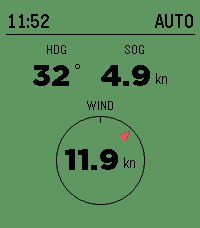

<!-- Generated by scripts/update_app_directory.py: do not edit by hand -->
[← All Pebble Developers](../developers.md)

# Iuri A.

*1 app · Last updated 2026-10-12 · [About these lists](../about-app-lists.md)*

Links: [Pebble App Store](https://apps.repebble.com/apps/dev/iuri-a_a1f82895eeb60348595af897) · [GitHub (iuriaranda)](https://github.com/iuriaranda)

<h2 class="app-name" id="app-bef8e6181d804c4aaa40c482"><a href="https://apps.repebble.com/bef8e6181d804c4aaa40c482">pebblek</a> v0.1.0</h2>
<a class="app-source" href="https://github.com/iuriaranda/pebblek" title="Source code" data-search-exclude>View source</a>

App

MIT Released 2026-07-02 Updated 2026-07-02

Runs on: Round 2, Time 2

PebbleK — SignalK boat monitor &amp; autopilot remote PebbleK turns your Pebble into a glanceable helm display and autopilot remote for boats running a SignalK server. Leave the phone in your pocket…

