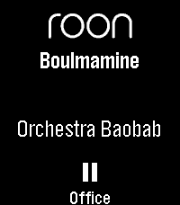
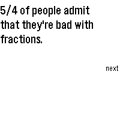
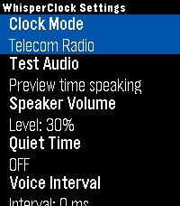

<!-- Generated by scripts/update_app_directory.py: do not edit by hand -->
[← All Pebble Developers](../developers.md)

# J\_B

*4 apps · Last updated 2026-10-11 · [About these lists](../about-app-lists.md)*

Links: [Pebble App Store](https://apps.repebble.com/apps/dev/j-b_68ecfdbe1c671100088152be) · [GitHub (JunderscoreB)](https://github.com/JunderscoreB) · [Website (community.roonlabs.com)](https://community.roonlabs.com/t/pebble-smartwatch-app-and-corresponding-roon-extension/313874)

<button type="button" data-filter="all" aria-pressed="true">All 4</button><button type="button" data-filter="watchface" aria-pressed="false" disabled>Watchfaces 0</button><button type="button" data-filter="watchapp" aria-pressed="false">Apps 4</button>

<label class="dev-sort">Sort by <select><option value="updated">Recently updated</option><option value="released">Newest release</option><option value="title">A–Z</option></select></label>

<h2 class="app-name" id="app-696edc515cd4fc0009ce6f5c"><a href="https://apps.repebble.com/696edc515cd4fc0009ce6f5c">Roon Remote for Pebble</a> v2.0.0</h2>
<a class="app-source" href="https://github.com/JunderscoreB/pebble-roon-remote" title="Source code" data-search-exclude>View source</a>

App · <a href="https://forum.rebble.io/t/532" title="Discuss this app on the Rebble forum" data-search-exclude>Forum thread</a>

MIT Released 2026-01-20 Updated 2026-10-09

Runs on: Round 2, Time 2, Pebble 2 Duo, Pebble 2, Time Round, Time, Classic

Roon Remote is a Pebble app that connects seamlessly to your Roon Core, letting you manage your audiophile endpoints without ever reaching for your phone. KEY FEATURES - Complete Playback Control…

<h2 class="app-name" id="app-47158bcba0984d6ca2628543"><a href="https://apps.repebble.com/47158bcba0984d6ca2628543">Dad Jokes</a> v1.6.1</h2>
<a class="app-source" href="https://github.com/JunderscoreB/dad-jokes" title="Source code" data-search-exclude>View source</a>

App

MIT Released 2026-09-17 Updated 2026-10-07

Runs on: Round 2, Time 2, Pebble 2 Duo, Pebble 2, Time Round, Time, Classic

Get ready to roll your eyes and groan. Dad Jokes delivers over 1100 of the finest, most agonizingly punny dad jokes right to your wrist. Built from the ground up for the 2026 Core Devices Pebble…

<h2 class="app-name" id="app-3bc29e330de34d74b6f52c2a"><a href="https://apps.repebble.com/3bc29e330de34d74b6f52c2a">BAC2Sober</a> v1.2.2</h2>
<a class="app-source" href="https://github.com/JunderscoreB/BAC2Sober" title="Source code" data-search-exclude>View source</a>

App

MIT Released 2026-08-07 Updated 2026-10-04

Runs on: Round 2, Time 2, Pebble 2 Duo, Pebble 2, Time Round, Time, Classic

BAC2Sober is a premium, real-time blood alcohol tracking companion for your Pebble smartwatch. Built with a focus on speed, privacy, and native Pebble aesthetics, it utilizes the trusted Widmark…

<h2 class="app-name" id="app-5b885cbac419464b82c27e75"><a href="https://apps.repebble.com/5b885cbac419464b82c27e75">WhisperClock</a> v1.2.6</h2>
<a class="app-source" href="https://github.com/JunderscoreB/whisperclock" title="Source code" data-search-exclude>View source</a>

App

MIT Released 2026-05-28 Updated 2026-07-16

Runs on: Time 2

Timekeeping should be accessible to everyone, in any situation. WhisperClock is a discrete, audio-first utility designed exclusively for the Pebble Time 2, delivering the exact time directly to…

