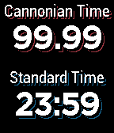

<!-- Generated by scripts/update_app_directory.py: do not edit by hand -->
[← All Pebble Developers](../developers.md)

# Jack Cannon

*1 watchface · Last updated 2026-10-12 · [About these lists](../about-app-lists.md)*

Links: [Pebble App Store](https://apps.repebble.com/apps/dev/jack-cannon_53f0d5d50a696ff0720000ce) · [GitHub (jackcannon)](https://github.com/jackcannon) · [Website (its.cannonianti.me)](http://its.cannonianti.me)

<h2 class="app-name" id="app-53fb32c9dcc3e56ad900011c"><a href="https://apps.repebble.com/53fb32c9dcc3e56ad900011c">Cannonian Time</a> v1.1</h2>
<a class="app-source" href="https://github.com/jackcannon/pebble-cannonian" title="Source code" data-search-exclude>View source</a>

Watchface

No licence Released 2014-08-25 Updated 2015-08-25

Runs on: Time 2, Pebble 2 Duo, Pebble 2, Time, Classic

Digital watchface that displays both Cannonian Time and standard time. Cannonian Time is a metric time system, based on the premise of 100 hours in a day. More information about Cannonian Time can…

