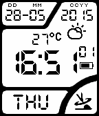
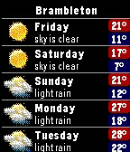
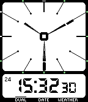
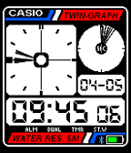
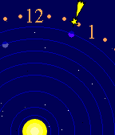

<!-- Generated by scripts/update_app_directory.py: do not edit by hand -->
[← All Pebble Developers](../developers.md)

# Jack T.

*7 watchfaces · Last updated 2026-10-11 · [About these lists](../about-app-lists.md)*

Links: [Pebble App Store](https://apps.repebble.com/apps/dev/jack-t_52ea054f156ab45eae00000f) · [GitHub (PanicMan)](https://github.com/PanicMan)

<button type="button" data-filter="all" aria-pressed="true">All 7</button><button type="button" data-filter="watchface" aria-pressed="false">Watchfaces 7</button><button type="button" data-filter="watchapp" aria-pressed="false" disabled>Apps 0</button>

<label class="dev-sort">Sort by <select><option value="updated">Recently updated</option><option value="released">Newest release</option><option value="title">A–Z</option></select></label>

<h2 class="app-name" id="app-52f2107ae21be4b82000117d"><a href="https://apps.repebble.com/52f2107ae21be4b82000117d">Fuzzy Analog</a> v3.2</h2>
<a class="app-source" href="https://github.com/PanicMan/Pebble-FuzzyAnalog" title="Source code" data-search-exclude>View source</a>

Watchface

No licence Released 2014-02-05 Updated 2016-10-25

Runs on: Round 2, Time 2, Pebble 2 Duo, Pebble 2, Time Round, Time, Classic

Pebble implementation of the following clock: http://i.imgur.com/Bf4C7nZ.gif Credits for the Idea goes to hop-picker ( http://hop-picker.tumblr.com ) as he first posted the concept of this kind of…

<h2 class="app-name" id="app-52f0ad814ae3634df7000259"><a href="https://apps.repebble.com/52f0ad814ae3634df7000259">Casio-WV-58DE</a> v2.10</h2>
<a class="app-source" href="https://github.com/PanicMan/Pebble-Casio-WV58DE" title="Source code" data-search-exclude>View source</a>

Watchface

No licence Released 2014-02-04 Updated 2016-10-17

Runs on: Time 2, Pebble 2 Duo, Pebble 2, Time, Classic

A Watchface of my previous Watch, an Casio-WV-58DE. With Weather, Bluetooth, Battery and DST Status. Weather update every hour. This is the original Watch…

<h2 class="app-name" id="app-555df17c4c222225560000a9"><a href="https://apps.repebble.com/555df17c4c222225560000a9">HTC Sense 6.3</a> v1.14</h2>
<a class="app-source" href="https://github.com/PanicMan/Pebble-HTC-Sense-6.3" title="Source code" data-search-exclude>View source</a>

Watchface

No licence Released 2015-05-21 Updated 2016-09-26

Runs on: Time 2, Time

Like HTC Sense on my old HTC Sensation. Miss it... :( Fully customizable, with Weather and forecast for 5 days on shake. An special city or auto location for weather. Automatic language for en…

<h2 class="app-name" id="app-56a242b1956f0bdbf900003e"><a href="https://apps.repebble.com/56a242b1956f0bdbf900003e">CASIO AE-11W</a> v1.3</h2>
<a class="app-source" href="https://github.com/PanicMan/Pebble-Casio-AE-11W" title="Source code" data-search-exclude>View source</a>

Watchface

GPL-3.0 Released 2016-01-22 Updated 2016-01-26

Runs on: Time 2, Pebble 2 Duo, Pebble 2, Time, Classic

Pebble Clone of my old CASIO AE-11W watch. Shows Time in analog and digital, date and weather. Automatic switching or through shaking. Shows Battery level, charge and BT Status on the outer hour…

<h2 class="app-name" id="app-52f0d6cf1ac79487080027b7"><a href="https://apps.repebble.com/52f0d6cf1ac79487080027b7">Casio AE-20W</a> v2.6</h2>
<a class="app-source" href="https://github.com/PanicMan/Pebble-Casio-AE-20W" title="Source code" data-search-exclude>View source</a>

Watchface

No licence Released 2014-02-04 Updated 2016-01-20

Runs on: Time 2, Pebble 2 Duo, Pebble 2, Time, Classic

Watchface Clone of an Casio AE-20W, with fully worked Animations, like the original! This is the Original: http://www.vintagelcd.com/vul/item/642/

<h2 class="app-name" id="app-5308a86a92c45e81df00026b"><a href="https://apps.repebble.com/5308a86a92c45e81df00026b">Planetarium</a> v3.0</h2>
<a class="app-source" href="https://github.com/PanicMan/Pebble-Planetarium" title="Source code" data-search-exclude>View source</a>

Watchface

No licence Released 2014-02-22 Updated 2016-01-19

Runs on: Round 2, Time 2, Pebble 2 Duo, Pebble 2, Time Round, Time, Classic

Lean on the Watch of Van Cleef &amp; Arpels: Midnight Planetarium, this WatchFace shows the current state of our Solar System. To deal better with the small resolution, the screen show only a part of…

<h2 class="app-name" id="app-53298e8c73a31ab04d0003a3"><a href="https://apps.repebble.com/53298e8c73a31ab04d0003a3">Nadir</a> v2.0</h2>
<a class="app-source" href="https://github.com/PanicMan/Pebble-Nadir" title="Source code" data-search-exclude>View source</a>

Watchface

No licence Released 2014-03-19 Updated 2016-01-19

Runs on: Round 2, Time 2, Pebble 2 Duo, Pebble 2, Time Round, Time, Classic

As requested here an Watchface Clone of an Nadir Watch. This is the Original: http://projectswatches.com/shop/nadir/#prettyPhoto Here the Request…

