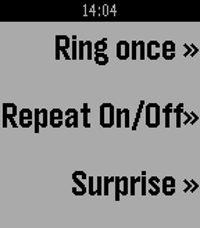

<!-- Generated by scripts/update_app_directory.py: do not edit by hand -->
[← All Pebble Developers](../developers.md)

# Jack Youstra

*1 app · Last updated 2026-10-11 · [About these lists](../about-app-lists.md)*

Links: [Rebble App Store](https://apps.rebble.io/en_US/developer/52f30e0f33661a1de70003b3/1) · [GitHub (JackYoustra)](https://github.com/JackYoustra)

<h2 class="app-name" id="app-5689b808b92fe59343000007"><a href="https://apps.rebble.io/en_US/application/5689b808b92fe59343000007">Phone Finder</a> v1.1</h2>
<a class="app-source" href="https://github.com/JackYoustra/Phone-Finder-Pebble" title="Source code" data-search-exclude>View source</a>

App

No licence Released 2016-01-04 Updated 2017-01-03 Rebble App Store

Runs on: Round 2, Time 2, Pebble 2 Duo, Pebble 2, Time Round, Time, Classic

A Bluetooth-Only phone finder Features: - Upper button: Ring phone once - Middle button: Toggle repeating ring - Bottom button: Surprise sound This app connects to the companion app, persistently…

