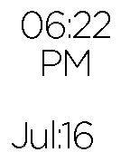

<!-- Generated by scripts/update_app_directory.py: do not edit by hand -->
[← All Pebble Developers](../developers.md)

# Jacob Nearon

*1 watchface · Last updated 2026-10-11 · [About these lists](../about-app-lists.md)*

Links: [Pebble App Store](https://apps.repebble.com/apps/dev/jacob-nearon_52f0787961b752d99e001be3)

<h2 class="app-name" id="app-53c041d5f3ce282d6d000004"><a href="https://apps.repebble.com/53c041d5f3ce282d6d000004">Simple</a> v2.0</h2>
<a class="app-source" href="https://cloudpebble.net/ide/project/68106#" title="Source code" data-search-exclude>View source</a>

Watchface

Released 2014-07-11 Updated 2014-07-17

Runs on: Time 2, Pebble 2 Duo, Pebble 2, Time, Classic

Simple and classy watch face.

