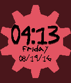

<!-- Generated by scripts/update_app_directory.py: do not edit by hand -->
[← All Pebble Developers](../developers.md)

# jadedResearcher

*1 watchface · Last updated 2026-10-11 · [About these lists](../about-app-lists.md)*

Links: [Pebble App Store](https://apps.repebble.com/apps/dev/jadedresearcher_531a60db2559afabd800088a) · [GitHub (gtg287y)](https://github.com/gtg287y)

<h2 class="app-name" id="app-57b71f91bb85eddc98000883"><a href="https://apps.repebble.com/57b71f91bb85eddc98000883">Homestuck Watch of Time</a> v1.3</h2>
<a class="app-source" href="https://github.com/gtg287y/GearWatch" title="Source code" data-search-exclude>View source</a>

Watchface

Released 2016-08-19 Updated 2016-10-04

Runs on: Round 2, Time 2, Time Round, Time

Homestuck Time Gear flashes and rotates once a second, on a dark red background. Time and date displayed using Dave Strider&#x27;s handwriting font, found here…

