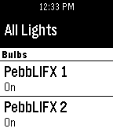

<!-- Generated by scripts/update_app_directory.py: do not edit by hand -->
[← All Pebble Developers](../developers.md)

# jadengore

*1 app · Last updated 2026-10-12 · [About these lists](../about-app-lists.md)*

Links: [Pebble App Store](https://apps.repebble.com/apps/dev/jadengore_530db4abae03dc219d00023d) · [GitHub (jadengore)](https://github.com/jadengore) · [Website (pebblifx.edwardbramanti.com)](http://pebblifx.edwardbramanti.com)

<h2 class="app-name" id="app-532f73624e66a650030003d9"><a href="https://apps.repebble.com/532f73624e66a650030003d9">PebbLIFX</a> v0.7</h2>
<a class="app-source" href="https://github.com/jadengore/PebbLIFX" title="Source code" data-search-exclude>View source</a>

App

MIT Released 2014-03-23 Updated 2014-04-22

Runs on: Time 2, Pebble 2 Duo, Pebble 2, Time, Classic

Control your LIFX bulbs from your Pebble Watch. Currently supports bulb name discovery as well as on/off commands. This app will not work without the companion app on Android. This app is powered…

