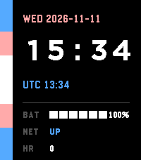

<!-- Generated by scripts/update_app_directory.py: do not edit by hand -->
[← All Pebble Developers](../developers.md)

# JAE

*1 watchface · Last updated 2026-11-16 · [About these lists](../about-app-lists.md)*

Links: [Pebble App Store](https://apps.repebble.com/apps/dev/jae_8f45f50dea6e83fd434e1445) · [GitHub (j4lc)](https://github.com/j4lc) · [Website (jae.fi)](https://jae.fi)

<h2 class="app-name" id="app-9bd4a0c9073646db9300da49"><a href="https://apps.repebble.com/9bd4a0c9073646db9300da49">TransTime HR</a> v1.0.2</h2>
<a class="app-source" href="https://github.com/j4lc/tt-pbl" title="Source code" data-search-exclude>View source</a>

Watchface

No licence Released 2026-11-11 Updated 2026-11-11

Runs on: Time 2

Fork of the TransTime watchface which removes the text at the bottom and replaces it with the latest heart rate metric. Not made for the round pebble.

