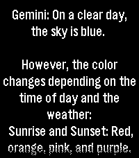

<!-- Generated by scripts/update_app_directory.py: do not edit by hand -->
[← All Pebble Developers](../developers.md)

# Jager

*1 app · Last updated 2026-10-11 · [About these lists](../about-app-lists.md)*

Links: [Pebble App Store](https://apps.repebble.com/apps/dev/jager_18c1392aeb0a87662b1c8517) · [GitHub (JagerSprinkles)](https://github.com/JagerSprinkles)

<h2 class="app-name" id="app-7996ad2f480d4549b3996f58"><a href="https://apps.repebble.com/7996ad2f480d4549b3996f58">PebbleAI+</a> v1.0.2</h2>
<a class="app-source" href="https://github.com/JagerSprinkles/PebbleAI-Plus" title="Source code" data-search-exclude>View source</a>

App

MIT Released 2026-10-03 Updated 2026-10-07

Runs on: Round 2, Time 2, Pebble 2 Duo, Pebble 2, Time Round, Time

Press button and talk to the AI of your choice! PebbleAI-Plus is a resource-aware fork of PebbleAI. It keeps the same idea of the original PebbleAI, access to ChatGPT, Gemini, DeepSeek, Grok, or…

