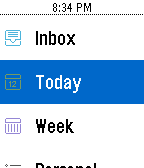

<!-- Generated by scripts/update_app_directory.py: do not edit by hand -->
[← All Pebble Developers](../developers.md)

# Jahdai Cintron

*1 app · Last updated 2026-10-11 · [About these lists](../about-app-lists.md)*

Links: [Pebble App Store](https://apps.repebble.com/apps/dev/jahdai-cintron_52b52785d2b97a2c6d00000e) · [GitHub (jahdaic)](https://github.com/jahdaic) · [Website (jahdaicintron.com)](http://jahdaicintron.com/wunderpebble/)

<h2 class="app-name" id="app-54aabf29ef47e1e246000072"><a href="https://apps.repebble.com/54aabf29ef47e1e246000072">WunderPebble</a> v2.11</h2>
<a class="app-source" href="https://github.com/jahdaic/WunderPebbleJS" title="Source code" data-search-exclude>View source</a>

App

Released 2015-01-05 Updated 2016-07-07

Runs on: Round 2, Time 2, Pebble 2 Duo, Pebble 2, Time Round, Time, Classic

An elegant and feature-filled Wunderlist client for your Pebble. View Lists and mark Tasks complete right on your wrist. I&#x27;m constantly adding new features. Visit my site and send me suggestions…

