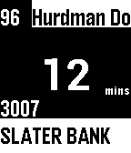

<!-- Generated by scripts/update_app_directory.py: do not edit by hand -->
[← All Pebble Developers](../developers.md)

# jaimeyu

*1 app · Last updated 2026-10-11 · [About these lists](../about-app-lists.md)*

Links: [Pebble App Store](https://apps.repebble.com/apps/dev/jaimeyu_52a93f0f79c18fa72400001e) · [GitHub (jaimeyu)](https://github.com/jaimeyu) · [Website (ottawa.travvik.com)](http://ottawa.travvik.com)

<h2 class="app-name" id="app-52b26ea9b70e1c131c0000cf"><a href="https://apps.repebble.com/52b26ea9b70e1c131c0000cf">Travvik</a> v3.3</h2>
<a class="app-source" href="https://github.com/jaimeyu/travvik_pebble_3" title="Source code" data-search-exclude>View source</a>

App

Released 2013-12-19 Updated 2015-03-24

Runs on: Time 2, Pebble 2 Duo, Pebble 2, Time, Classic

This app will keep you to up to date on your next upcoming OC Transpo bus. It periodically updates itself so it will always have the latest information for you. Button layout: UP -&gt; Select bus…

