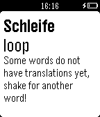
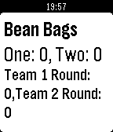

<!-- Generated by scripts/update_app_directory.py: do not edit by hand -->
[← All Pebble Developers](../developers.md)

# Jake Schultz

*2 apps · Last updated 2026-10-11 · [About these lists](../about-app-lists.md)*

Links: [Rebble App Store](https://apps.rebble.io/en_US/developer/52f0f7a24ae3634df7000b35/1) · [Pebble App Store](https://apps.repebble.com/apps/dev/jake-schultz_52f0f7a24ae3634df7000b35) · [GitHub (iamjake648)](https://github.com/iamjake648) · [Website (iamjake648.com)](http://iamjake648.com)

<button type="button" data-filter="all" aria-pressed="true">All 2</button><button type="button" data-filter="watchface" aria-pressed="false" disabled>Watchfaces 0</button><button type="button" data-filter="watchapp" aria-pressed="false">Apps 2</button>

<label class="dev-sort">Sort by <select><option value="updated">Recently updated</option><option value="released">Newest release</option><option value="title">A–Z</option></select></label>

<h2 class="app-name" id="app-547e7f9ec252df95770000c6"><a href="https://apps.rebble.io/en_US/application/547e7f9ec252df95770000c6">Word Shake</a> v1.0</h2>
<a class="app-source" href="https://github.com/iamjake648/wordshake_pebble" title="Source code" data-search-exclude>View source</a>

App

Released 2014-12-03 Updated 2014-12-06 Rebble App Store

Runs on: Time 2, Pebble 2 Duo, Pebble 2, Time, Classic

Word Shake for Pebble is a great app to quickly learn new vocab in new languages! Simply shake your pebble to see a brand new word! Over 4,000 words to learn and 8 languages!

<h2 class="app-name" id="app-53d873a30a91e8ee99000100"><a href="https://apps.repebble.com/53d873a30a91e8ee99000100">Bean Bags</a> v1.0</h2>
<a class="app-source" href="http://pastie.org/9430766" title="Source code" data-search-exclude>View source</a>

App

Released 2014-07-30 Updated 2014-07-30

Runs on: Time 2, Pebble 2 Duo, Pebble 2, Time, Classic

A great app to keep score of your bean bags game! Controls: Up and Down: Change the round score up or down Up and Down Hold: Change the score by three Select: Toggle between teams Select Hold…

