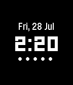

<!-- Generated by scripts/update_app_directory.py: do not edit by hand -->
[← All Pebble Developers](../developers.md)

# Jake Zimmerman

*1 watchface · Last updated 2026-10-12 · [About these lists](../about-app-lists.md)*

Links: [Rebble App Store](https://apps.rebble.io/en_US/developer/531fe9fc0f3ef7275900002c/1) · [GitHub (jez)](https://github.com/jez)

<h2 class="app-name" id="app-597b8f670dfc32af61001d35"><a href="https://apps.rebble.io/en_US/application/597b8f670dfc32af61001d35">Minimal Black</a> v0.9</h2>
<a class="app-source" href="https://github.com/jez/pebble-minimal-black" title="Source code" data-search-exclude>View source</a>

Watchface

MIT Released 2017-07-28 Updated 2017-07-28 Rebble App Store

Runs on: Round 2, Time 2, Pebble 2 Duo, Pebble 2, Time Round, Time, Classic

Time, battery indicator, and simple date indicator. Also shows &quot;no bluetooth&quot; icon when disconnected.

