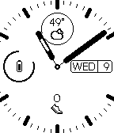
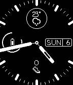

<!-- Generated by scripts/update_app_directory.py: do not edit by hand -->
[← All Pebble Developers](../developers.md)

# Jakerusch

*4 watchfaces · Last updated 2026-10-12 · [About these lists](../about-app-lists.md)*

Links: [Pebble App Store](https://apps.repebble.com/apps/dev/jakerusch_5744715f00693fd87600000b) · [GitHub (jakerusch)](https://github.com/jakerusch)

<button type="button" data-filter="all" aria-pressed="true">All 4</button><button type="button" data-filter="watchface" aria-pressed="false">Watchfaces 4</button><button type="button" data-filter="watchapp" aria-pressed="false" disabled>Apps 0</button>

<label class="dev-sort">Sort by <select><option value="updated">Recently updated</option><option value="released">Newest release</option><option value="title">A–Z</option></select></label>

<h2 class="app-name" id="app-581d4b599cbbaf2ef200015d"><a href="https://apps.repebble.com/581d4b599cbbaf2ef200015d">Perfect Analog</a> v1.8</h2>
<a class="app-source" href="https://github.com/jakerusch/DIAL_V4" title="Source code" data-search-exclude>View source</a>

Watchface

No licence Released 2016-11-05 Updated 2017-05-22

Runs on: Round 2, Time 2, Pebble 2 Duo, Pebble 2, Time Round, Time, Classic

This is Perfect Analog in Fahrenheit (look for Perfect Analog Celsius if you want the Celsius version). It provides temperature, weather conditions, weekday, day of month, health, and battery…

<h2 class="app-name" id="app-581fb098e7785b8942000001"><a href="https://apps.repebble.com/581fb098e7785b8942000001">Perfect Analog Celsuius</a> v1.6</h2>
<a class="app-source" href="https://www.github.com/jakerusch/DIAL_V4" title="Source code" data-search-exclude>View source</a>

Watchface

Released 2016-11-06 Updated 2016-11-30

Runs on: Round 2, Time 2, Pebble 2 Duo, Pebble 2, Time Round, Time, Classic

This is Perfect Analog Celsius (look for Perfect Analog if you want the Fahrenheit version). It provides temperature, weather conditions, weekday, day of month, health, and battery status. Weather…

<h2 class="app-name" id="app-5838a47d00355a8e27000515"><a href="https://apps.repebble.com/5838a47d00355a8e27000515">The Division Celsius</a> v1.0</h2>
<a class="app-source" href="https://github.com/jakerusch/THE_DIVISION_2" title="Source code" data-search-exclude>View source</a>

Watchface

No licence Released 2016-11-25 Updated 2016-11-25

Runs on: Time 2, Pebble 2 Duo, Pebble 2, Time, Classic

The Division watchface for APLITE, BASALT, AND DORITE. Displays day of week, month, and day of month, battery level, bluetooth connectivity, city/location and current weather in Celsius.

<h2 class="app-name" id="app-5820d9c034da21cdc50000bb"><a href="https://apps.repebble.com/5820d9c034da21cdc50000bb">The Division</a> v1.0</h2>
<a class="app-source" href="https://github.com/jakerusch/the_division_2" title="Source code" data-search-exclude>View source</a>

Watchface

No licence Released 2016-11-07 Updated 2016-11-08

Runs on: Time 2, Pebble 2 Duo, Pebble 2, Time, Classic

The Division watchface for APLITE, BASALT, AND DORITE. Displays day of week, month, and day of month, battery level, bluetooth connectivity, city/location and current weather in Fahrenheit.

