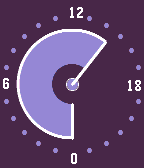
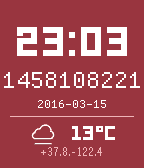

<!-- Generated by scripts/update_app_directory.py: do not edit by hand -->
[← All Pebble Developers](../developers.md)

# James Brown

*2 watchfaces · Last updated 2026-10-11 · [About these lists](../about-app-lists.md)*

Links: [Pebble App Store](https://apps.repebble.com/apps/dev/james-brown_52f009f94ae3630fc1000085) · [GitHub (Roguelazer)](https://github.com/Roguelazer)

<button type="button" data-filter="all" aria-pressed="true">All 2</button><button type="button" data-filter="watchface" aria-pressed="false">Watchfaces 2</button><button type="button" data-filter="watchapp" aria-pressed="false" disabled>Apps 0</button>

<label class="dev-sort">Sort by <select><option value="updated">Recently updated</option><option value="released">Newest release</option><option value="title">A–Z</option></select></label>

<h2 class="app-name" id="app-57018c2e83140d0ed700000c"><a href="https://apps.repebble.com/57018c2e83140d0ed700000c">24 Hours of Color</a> v0.1</h2>
<a class="app-source" href="https://github.com/Roguelazer/24hOfColor" title="Source code" data-search-exclude>View source</a>

Watchface

No licence Released 2016-04-03 Updated 2016-04-03

Runs on: Round 2, Time 2, Pebble 2 Duo, Pebble 2, Time Round, Time, Classic

Simple 24-hour watchface (with midnight at the bottom and noon at the top) that wanders through random (hopefully attractive color combinations).

<h2 class="app-name" id="app-56e26f1326f50d3de200004d"><a href="https://apps.repebble.com/56e26f1326f50d3de200004d">*nixTime</a> v1.7</h2>
<a class="app-source" href="https://github.com/Roguelazer/nixTime" title="Source code" data-search-exclude>View source</a>

Watchface

ISC Released 2016-03-11 Updated 2016-03-17

Runs on: Round 2, Time 2, Pebble 2 Duo, Pebble 2, Time Round, Time, Classic

Really simple Pebble watchface which displays the current time, the current date, and the current Unix Timestamp (&quot;epoch time&quot;). Unlike every other epoch time watchface I could find, it only…

