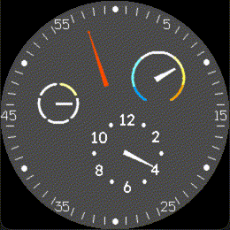

<!-- Generated by scripts/update_app_directory.py: do not edit by hand -->
[← All Pebble Developers](../developers.md)

# James DelVesco

*1 watchface · Last updated 2026-10-12 · [About these lists](../about-app-lists.md)*

Links: [Pebble App Store](https://apps.repebble.com/apps/dev/james-delvesco_45ad03d5bf2d276b8fb69cff) · [GitHub (realslimjd)](https://github.com/realslimjd)

<h2 class="app-name" id="app-fbb7263a84a349ad8c45cbb9"><a href="https://apps.repebble.com/fbb7263a84a349ad8c45cbb9">Essence</a> v1.0.1</h2>
<a class="app-source" href="https://github.com/realslimjd/pebble-essence" title="Source code" data-search-exclude>View source</a>

Watchface

Released 2026-04-16 Updated 2026-04-16

Runs on: Round 2

This is a watchface made in the style of the Ressence Type 3. It has indicators for minutes, hours, battery level, and the outside temperature.

