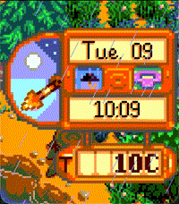
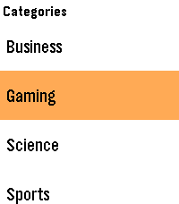
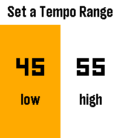
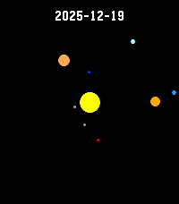
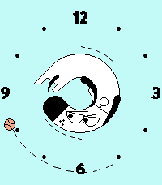

<!-- Generated by scripts/update_app_directory.py: do not edit by hand -->
[← All Pebble Developers](../developers.md)

# James Downs

*2 watchfaces and 5 apps · Last updated 2026-10-12 · [About these lists](../about-app-lists.md)*

Links: [Rebble App Store](https://apps.rebble.io/en_US/developer/5308eabf92c45e5f39000503/1) · [GitHub (CometDog)](https://github.com/CometDog) · [GitHub (PiwwowPants)](https://github.com/PiwwowPants)

<button type="button" data-filter="all" aria-pressed="true">All 7</button><button type="button" data-filter="watchface" aria-pressed="false">Watchfaces 2</button><button type="button" data-filter="watchapp" aria-pressed="false">Apps 5</button>

<label class="dev-sort">Sort by <select><option value="updated">Recently updated</option><option value="released">Newest release</option><option value="title">A–Z</option></select></label>

<h2 class="app-name" id="app-69d28981b11d33000a28cc13"><a href="https://apps.rebble.io/en_US/application/69d28981b11d33000a28cc13">Pixel Pastures</a> v1.10.0</h2>
<a class="app-source" href="https://github.com/CometDog/pebble-pixel-pastures-face" title="Source code" data-search-exclude>View source</a>

Watchface · <a href="https://forum.rebble.io/t/830" title="Discuss this app on the Rebble forum" data-search-exclude>Forum thread</a>

GPL-3.0 Released 2026-04-05 Updated 2026-07-10 Rebble App Store

Runs on: Round 2, Time 2, Pebble 2 Duo, Pebble 2, Time Round, Time, Classic

Bring the cozy farm clock to your wrist This watchface recreates the look and feel of the beloved farming game with Pebble-ready pixel art inspired by the original. How to use: - Configure showing…

<h2 class="app-name" id="app-692b3f0549be450009b545ce"><a href="https://apps.rebble.io/en_US/application/692b3f0549be450009b545ce">Kagi News</a> v1.27.2</h2>
<a class="app-source" href="https://github.com/CometDog/pebble-kite" title="Source code" data-search-exclude>View source</a>

App · <a href="https://forum.rebble.io/t/85" title="Discuss this app on the Rebble forum" data-search-exclude>Forum thread</a>

GPL-3.0 Released 2025-11-29 Updated 2026-06-18 Rebble App Store

Runs on: Round 2, Time 2, Pebble 2 Duo, Pebble 2, Time Round, Time

Unofficial front-end for Kagi News. About the App: !NEW! Now supports touch-based navigation on Pebble Time 2 and Pebble Round 2. Scroll up and down on menus and stories. Scroll left and right to…

<h2 class="app-name" id="app-6975959f0791ce000af8163e"><a href="https://apps.rebble.io/en_US/application/6975959f0791ce000af8163e">Tap Tap</a> v1.1</h2>
<a class="app-source" href="https://github.com/CometDog/pebble-tap-tempo" title="Source code" data-search-exclude>View source</a>

App · <a href="https://forum.rebble.io/t/567" title="Discuss this app on the Rebble forum" data-search-exclude>Forum thread</a>

No licence Released 2026-01-25 Updated 2026-01-31 Rebble App Store

Runs on: Round 2, Time 2, Pebble 2 Duo, Pebble 2, Time Round, Time, Classic

A general tempo finder utility For me, this replaces the PuckPuck app on iOS for keeping track of the tempo of my cold drip coffee. Setting a tempo range at which I want the coffee to drip, I can…

<h2 class="app-name" id="app-68cf73f6e9a54400096dd548"><a href="https://apps.rebble.io/en_US/application/68cf73f6e9a54400096dd548">Can I See Fuji?</a> v1.2</h2>
<a class="app-source" href="https://github.com/CometDog/pebble-can-i-see-fuji" title="Source code" data-search-exclude>View source</a>

App · <a href="https://forum.rebble.io/t/306" title="Discuss this app on the Rebble forum" data-search-exclude>Forum thread</a>

No licence Released 2025-09-21 Updated 2026-01-25 Rebble App Store

Runs on: Round 2, Time 2, Pebble 2 Duo, Pebble 2, Time Round, Time, Classic

Indicates if you&#x27;ll be able to see Mt. Fuji today (JST) from the North Side (Oishi Park) and the South Side (Fuji City) Press up or down on your watch to switch between the North and South side…

<h2 class="app-name" id="app-6944f2e9da1501000896b74a"><a href="https://apps.rebble.io/en_US/application/6944f2e9da1501000896b74a">Planetarium</a> v1.1</h2>
<a class="app-source" href="https://github.com/CometDog/SolarSystem" title="Source code" data-search-exclude>View source</a>

App · <a href="https://forum.rebble.io/t/309" title="Discuss this app on the Rebble forum" data-search-exclude>Forum thread</a>

No licence Released 2025-12-19 Updated 2025-12-20 Rebble App Store

Runs on: Round 2, Time 2, Pebble 2 Duo, Pebble 2, Time Round, Time, Classic

View the relative positions of the planets on any day This app lets you simulate the positions of the planets on a 2D plane. Many liberties are taken to position the planets on the low resolution…

<h2 class="app-name" id="app-68361a83a9c183000a8f714a"><a href="https://apps.rebble.io/en_US/application/68361a83a9c183000a8f714a">Kagi Doggo</a> v1.4</h2>
<a class="app-source" href="https://github.com/CometDog/pebble-kagi-doggo" title="Source code" data-search-exclude>View source</a>

Watchface

No licence Released 2025-05-27 Updated 2025-11-05 Rebble App Store

Runs on: Round 2, Time 2, Pebble 2 Duo, Pebble 2, Time Round, Time, Classic

Displays the time with the Kagi Doggo&#x27;s toes as the hour hand chasing the ball as the minute hand. Please note, I am not affiliated with Kagi, I am just a user. More information about Kagi can be…

<h2 class="app-name" id="app-58392179ca3094bdc00002ba"><a href="https://apps.rebble.io/en_US/application/58392179ca3094bdc00002ba">Breathe</a> v1.0</h2>
<a class="app-source" href="https://github.com/PiwwowPants/Breathe" title="Source code" data-search-exclude>View source</a>

App

No licence Released 2016-11-26 Updated 2016-11-26 Rebble App Store

Runs on: Round 2, Time 2, Pebble 2 Duo, Pebble 2, Time Round, Time, Classic

An app to lead you through some simple breathing. &quot;min&quot; is minutes and &quot;bpm&quot; is how many breaths you wish to do a minute.

