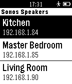

<!-- Generated by scripts/update_app_directory.py: do not edit by hand -->
[← All Pebble Developers](../developers.md)

# James Fairhurst

*1 app · Last updated 2026-10-11 · [About these lists](../about-app-lists.md)*

Links: [Pebble App Store](https://apps.repebble.com/apps/dev/james-fairhurst_53edfa2ed7d50558e00000fd) · [GitHub (jamesfairhurst)](https://github.com/jamesfairhurst)

<h2 class="app-name" id="app-546a1fefecee192af60000c1"><a href="https://apps.repebble.com/546a1fefecee192af60000c1">Pebbos</a> v1.0</h2>
<a class="app-source" href="https://github.com/jamesfairhurst/Pebbos" title="Source code" data-search-exclude>View source</a>

App

Released 2014-11-17 Updated 2014-11-17

Runs on: Time 2, Pebble 2 Duo, Pebble 2, Time, Classic

A simple Pebble.js app that allows you to control your Sonos speakers with your Pebble.

