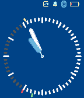
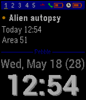

<!-- Generated by scripts/update_app_directory.py: do not edit by hand -->
[← All Pebble Developers](../developers.md)

# James Fowler

*3 watchfaces and 2 apps · Last updated 2026-10-11 · [About these lists](../about-app-lists.md)*

Links: [Pebble App Store](https://apps.repebble.com/apps/dev/james-fowler_52b208abb70e1ced1f00004c) · [Rebble App Store](https://apps.rebble.io/en_US/developer/52b208abb70e1ced1f00004c/1) · [GitHub (JamesFowler42)](https://github.com/JamesFowler42) · [Website (morpheuz.net)](http://www.morpheuz.net/p/instructions.html)

<button type="button" data-filter="all" aria-pressed="true">All 5</button><button type="button" data-filter="watchface" aria-pressed="false">Watchfaces 3</button><button type="button" data-filter="watchapp" aria-pressed="false">Apps 2</button>

<label class="dev-sort">Sort by <select><option value="updated">Recently updated</option><option value="released">Newest release</option><option value="title">A–Z</option></select></label>

<h2 class="app-name" id="app-52b20a9b05c04688bf000058"><a href="https://apps.repebble.com/52b20a9b05c04688bf000058">Morpheuz</a> v4.6</h2>
<a class="app-source" href="https://github.com/JamesFowler42/morpheuz20" title="Source code" data-search-exclude>View source</a>

App

Other Released 2013-12-18 Updated 2019-07-24

Runs on: Round 2, Time 2, Pebble 2 Duo, Pebble 2, Time Round, Time, Classic

A Complete Sleep App For Pebble. * Smart Alarm with Snooze * Sleep Movement Charts * Digital and Analogue Faces * Voice Control * Powernap * Daily charts sent to Pushover * Daily sleep time sent…

<h2 class="app-name" id="app-56c48fe5a5d04988fb000039"><a href="https://apps.repebble.com/56c48fe5a5d04988fb000039">My TicToc</a> v1.0</h2>
<a class="app-source" href="https://github.com/JamesFowler42/MyTicToc" title="Source code" data-search-exclude>View source</a>

Watchface

Other Released 2016-02-17 Updated 2016-02-17

Runs on: Round 2, Time 2, Pebble 2 Duo, Pebble 2, Time Round, Time, Classic

I love the standard Pebble Tic-Toc watchface with all the nice animations, but I wanted to know bluetooth and battery status without spoiling the uncluttered simplicity. On this version the hour…

<h2 class="app-name" id="app-561c1c264af08f0e19000005"><a href="https://apps.repebble.com/561c1c264af08f0e19000005">Alvin</a> v1.3</h2>
<a class="app-source" href="https://github.com/JamesFowler42/alvin" title="Source code" data-search-exclude>View source</a>

App

Other Released 2015-10-12 Updated 2015-12-21

Runs on: Round 2, Time 2, Pebble 2 Duo, Pebble 2, Time Round, Time, Classic

1.3: Fixed issue with key being lost on Android Alvin is intended to be the easist and quickest to use way to control IFTTT recipies using the Maker channel. * Voice recognition * Reorderable menu…

<h2 class="app-name" id="app-52e79fe4f6e72005f7000016"><a href="https://apps.rebble.io/en_US/application/52e79fe4f6e72005f7000016">Diary Face 2.0</a> v2.7</h2>
<a class="app-source" href="https://github.com/JamesFowler42/diaryface20" title="Source code" data-search-exclude>View source</a>

Watchface

No licence Released 2014-01-28 Updated 2015-06-20 Rebble App Store

Runs on: Time 2, Pebble 2 Duo, Pebble 2, Time, Classic

Smartwatch Pro animated calendar watchface. Relative dates on events. 12/24 hr. Speeds up when you are moving, slows down to save battery when you are not. Watchface settings from inside…

<h2 class="app-name" id="app-52dda2b481cae254ac000005"><a href="https://apps.repebble.com/52dda2b481cae254ac000005">No Fuss</a> v1.0.0</h2>
<a class="app-source" href="https://github.com/JamesFowler42/nofuss" title="Source code" data-search-exclude>View source</a>

Watchface

No licence Released 2014-01-20 Updated 2014-01-20

Runs on: Time 2, Pebble 2 Duo, Pebble 2, Time, Classic

Simple no fuss watch face. Flashing bluetooth indicator on disconnection. Battery state when less than 20% or on charge.

