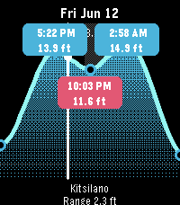

<!-- Generated by scripts/update_app_directory.py: do not edit by hand -->
[← All Pebble Developers](../developers.md)

# James Roland

*1 app · Last updated 2026-10-12 · [About these lists](../about-app-lists.md)*

Links: [Pebble App Store](https://apps.repebble.com/apps/dev/james-roland_74b1dca27068ad03cb37e37d) · [GitHub (gli-james-roland)](https://github.com/gli-james-roland)

<h2 class="app-name" id="app-de7fc2dccd464e299badc6c0"><a href="https://apps.repebble.com/de7fc2dccd464e299badc6c0">Pebble Tides</a> v1.0.10</h2>
<a class="app-source" href="https://github.com/gli-james-roland/pebble-tide" title="Source code" data-search-exclude>View source</a>

App

No licence Released 2026-06-08 Updated 2026-07-03

Runs on: Round 2, Time 2, Pebble 2 Duo, Pebble 2, Time Round, Time, Classic

Pebble Tides shows the day&#x27;s tides at a glance: a graph of the high and low tides with their exact times and heights, the current water level, whether the tide is rising or falling, and optional…

