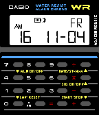
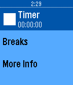

<!-- Generated by scripts/update_app_directory.py: do not edit by hand -->
[← All Pebble Developers](../developers.md)

# James Smith (@poeia)

*1 watchface and 1 app · Last updated 2026-10-12 · [About these lists](../about-app-lists.md)*

Links: [Pebble App Store](https://apps.repebble.com/apps/dev/james-smith-poeia_542ddd35d4d52c3f67000012) · [Rebble App Store](https://apps.rebble.io/en_US/developer/542ddd35d4d52c3f67000012/1) · [GitHub (poeia)](https://github.com/poeia) · [Website (about.me)](https://about.me/james-r-smith)

<button type="button" data-filter="all" aria-pressed="true">All 2</button><button type="button" data-filter="watchface" aria-pressed="false">Watchfaces 1</button><button type="button" data-filter="watchapp" aria-pressed="false">Apps 1</button>

<label class="dev-sort">Sort by <select><option value="updated">Recently updated</option><option value="released">Newest release</option><option value="title">A–Z</option></select></label>

<h2 class="app-name" id="app-581d407a9cbbafcd64000160"><a href="https://apps.repebble.com/581d407a9cbbafcd64000160">Casio CA-53W</a> v1.1</h2>
<a class="app-source" href="https://github.com/poeia/casio-ca-53w" title="Source code" data-search-exclude>View source</a>

Watchface

Released 2016-11-05 Updated 2016-11-09

Runs on: Time 2, Pebble 2 Duo, Pebble 2, Time, Classic

Casio CA-53W - The Retro Calculator Watch for the Pebble Step back into 80&#x27;s and 90&#x27;s pop culture with the Casio CA-53W, the retro calculator watch worn by Walter White from &quot;Breaking Bad&quot; and…

<h2 class="app-name" id="app-57fee4621fd66b81c50001e4"><a href="https://apps.rebble.io/en_US/application/57fee4621fd66b81c50001e4">Healthy Eyes</a> v1.0</h2>
<a class="app-source" href="https://github.com/poeia/healthy-eyes" title="Source code" data-search-exclude>View source</a>

App

Released 2016-10-13 Updated 2016-10-13 Rebble App Store

Runs on: Round 2, Time 2, Pebble 2 Duo, Pebble 2, Time Round, Time, Classic

Healthy Eyes - The Smart Pomodoro Timer for Pebble Do you find yourself staring at screens for long periods of time, eventually leading to headaches? Or, are you working on a task, only to find…

