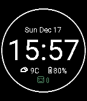

<!-- Generated by scripts/update_app_directory.py: do not edit by hand -->
[← All Pebble Developers](../developers.md)

# James Woo

*1 watchface · Last updated 2026-10-11 · [About these lists](../about-app-lists.md)*

Links: [Rebble App Store](https://apps.rebble.io/en_US/developer/5a31b9ec0dfc32dba00012da/1) · [GitHub (koredev)](https://github.com/koredev)

<h2 class="app-name" id="app-5a36b58b461a8dfe42001479"><a href="https://apps.rebble.io/en_US/application/5a36b58b461a8dfe42001479">kface</a> v1.2</h2>
<a class="app-source" href="https://github.com/koredev/kface" title="Source code" data-search-exclude>View source</a>

Watchface

Released 2017-12-17 Updated 2017-12-17 Rebble App Store

Runs on: Round 2, Time 2, Pebble 2 Duo, Pebble 2, Time Round, Time, Classic

Get time, date, weather, battery, and step information

