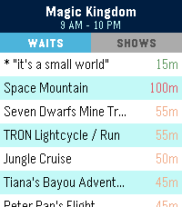
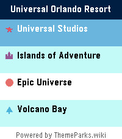
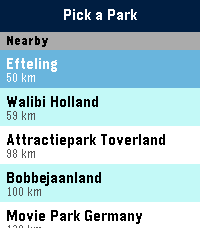

<!-- Generated by scripts/update_app_directory.py: do not edit by hand -->
[← All Pebble Developers](../developers.md)

# Jamie Holding

*3 apps · Last updated 2026-10-11 · [About these lists](../about-app-lists.md)*

Links: [Pebble App Store](https://apps.repebble.com/apps/dev/jamie-holding_30b1c336b9f7ddf808f16c5f) · [GitHub (ThemeParks)](https://github.com/ThemeParks) · [Website (themeparks.wiki)](https://themeparks.wiki)

<button type="button" data-filter="all" aria-pressed="true">All 3</button><button type="button" data-filter="watchface" aria-pressed="false" disabled>Watchfaces 0</button><button type="button" data-filter="watchapp" aria-pressed="false">Apps 3</button>

<label class="dev-sort">Sort by <select><option value="updated">Recently updated</option><option value="released">Newest release</option><option value="title">A–Z</option></select></label>

<h2 class="app-name" id="app-00ae673262094c56bd404d14"><a href="https://apps.repebble.com/00ae673262094c56bd404d14">WDW Queues</a> v1.4.0</h2>
<a class="app-source" href="https://github.com/ThemeParks/pebble" title="Source code" data-search-exclude>View source</a>

App

MIT Released 2026-04-15 Updated 2026-08-02

Runs on: Round 2, Time 2

Skip the guesswork. WDW Queues brings live Walt Disney World data straight to your Pebble — no phone-fumbling, no app-switching, no squinting at a tiny map. What you get: - Live wait times for…

<h2 class="app-name" id="app-05578696ebbd4e9b82110fea"><a href="https://apps.repebble.com/05578696ebbd4e9b82110fea">UOR Queues</a> v1.4.0</h2>
<a class="app-source" href="https://github.com/ThemeParks/pebble" title="Source code" data-search-exclude>View source</a>

App

MIT Released 2026-07-30 Updated 2026-08-02

Runs on: Round 2, Time 2

Skip the guesswork. UOR Queues brings live Universal Orlando Resort data straight to your Pebble — no phone-fumbling, no app-switching, no squinting at a tiny map. What you get: - Live wait times…

<h2 class="app-name" id="app-533b48a130db491a96830e41"><a href="https://apps.repebble.com/533b48a130db491a96830e41">ThemePark Queues</a> v1.4.0</h2>
<a class="app-source" href="https://github.com/ThemeParks/pebble" title="Source code" data-search-exclude>View source</a>

App

MIT Released 2026-04-18 Updated 2026-08-02

Runs on: Round 2, Time 2

Skip the guesswork. TP Queues brings live theme-park data straight to your Pebble — for every park, worldwide. No phone-fumbling, no app-switching, no squinting at a tiny map. Pick a destination…

