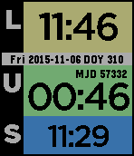

<!-- Generated by scripts/update_app_directory.py: do not edit by hand -->
[← All Pebble Developers](../developers.md)

# Jamie Stevens

*1 watchface · Last updated 2026-10-11 · [About these lists](../about-app-lists.md)*

Links: [Pebble App Store](https://apps.repebble.com/apps/dev/jamie-stevens_560c51379c52a7768a000011) · [GitHub (ste616)](https://github.com/ste616)

<h2 class="app-name" id="app-563bf809d886bbd76400000d"><a href="https://apps.repebble.com/563bf809d886bbd76400000d">Sidereal Watchface</a> v1.2</h2>
<a class="app-source" href="https://github.com/ste616/pebble-sidereal-watchface" title="Source code" data-search-exclude>View source</a>

Watchface

Released 2015-11-06 Updated 2025-11-25

Runs on: Round 2, Time 2, Time Round, Time

Shows times useful for astronomers, including the day of year, local and UTC times, sidereal time (location selectable in the app configuration) and modified Julian date (MJD).

