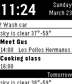

<!-- Generated by scripts/update_app_directory.py: do not edit by hand -->
[← All Pebble Developers](../developers.md)

# Jan Bobolz

*1 watchface · Last updated 2026-10-12 · [About these lists](../about-app-lists.md)*

Links: [Pebble App Store](https://apps.repebble.com/apps/dev/jan-bobolz_52d3bf8ef659f0fa38000016) · [GitHub (JanBobolz)](https://github.com/JanBobolz)

<h2 class="app-name" id="app-52e81244e822d1bdda00004a"><a href="https://apps.repebble.com/52e81244e822d1bdda00004a">Agenda Watchface</a> v2.14</h2>
<a class="app-source" href="https://github.com/JanBobolz" title="Source code" data-search-exclude>View source</a>

Watchface

Released 2014-01-28 Updated 2014-10-05

Runs on: Time 2, Pebble 2 Duo, Pebble 2, Time, Classic

Shows your upcoming appointments from the Android calendar. (And - with plugins - tasks, notifications, ...) Quite customizable. You need the companion app.

