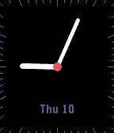

<!-- Generated by scripts/update_app_directory.py: do not edit by hand -->
[← All Pebble Developers](../developers.md)

# Jan Ehrhardt

*1 watchface · Last updated 2026-10-12 · [About these lists](../about-app-lists.md)*

Links: [Pebble App Store](https://apps.repebble.com/apps/dev/jan-ehrhardt_55f9a58675eb49b7a500008d) · [GitHub (jehrhardt)](https://github.com/jehrhardt)

<h2 class="app-name" id="app-56d55085fed1235a18000009"><a href="https://apps.repebble.com/56d55085fed1235a18000009">Potsdam</a> v2.0</h2>
<a class="app-source" href="https://github.com/jehrhardt/potsdam-watchface-pebble" title="Source code" data-search-exclude>View source</a>

Watchface

MIT Released 2016-03-01 Updated 2016-03-10

Runs on: Time 2, Time

A simple and elegant analog watchface for Pebble Time. It just shows the current minute, hour and date. It is much better readable than the Pebble Time&#x27;s default watchface Tictoc due to its tiny…

