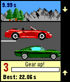
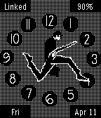

<!-- Generated by scripts/update_app_directory.py: do not edit by hand -->
[← All Pebble Developers](../developers.md)

# Jan Gruncl

*1 watchface and 1 app · Last updated 2026-10-12 · [About these lists](../about-app-lists.md)*

Links: [Pebble App Store](https://apps.repebble.com/apps/dev/jan-gruncl_52ea53e10cc6248ed300004b) · [GitHub (JohnyGQD)](https://github.com/JohnyGQD) · [Website (forum.xda-developers.com)](http://forum.xda-developers.com/pebble/pebble-development/competition-drag-racing-t2849592)

<button type="button" data-filter="all" aria-pressed="true">All 2</button><button type="button" data-filter="watchface" aria-pressed="false">Watchfaces 1</button><button type="button" data-filter="watchapp" aria-pressed="false">Apps 1</button>

<label class="dev-sort">Sort by <select><option value="updated">Recently updated</option><option value="released">Newest release</option><option value="title">A–Z</option></select></label>

<h2 class="app-name" id="app-54033c6886b01c8c15000138"><a href="https://apps.repebble.com/54033c6886b01c8c15000138">Drag Racing</a> v1.11.0</h2>
<a class="app-source" href="https://github.com/JohnyGQD/drag-racing-pebble" title="Source code" data-search-exclude>View source</a>

App

No licence Released 2014-08-31 Updated 2026-07-13

Runs on: Round 2, Time 2, Pebble 2 Duo, Pebble 2, Time Round, Time, Classic

XDA-Pebble Contest Winner It&#x27;s not easy to create a good game for Pebble that&#x27;s actually easy to control. Just a very few made this right. But there is a popular game genre that ought to be…

<h2 class="app-name" id="app-5343d66182ca8d0e600000f5"><a href="https://apps.repebble.com/5343d66182ca8d0e600000f5">Silly Walk 2</a> v2.2</h2>
<a class="app-source" href="https://github.com/JohnyGQD/pebble-silly-walk" title="Source code" data-search-exclude>View source</a>

Watchface

No licence Released 2014-04-08 Updated 2014-04-11

Runs on: Time 2, Pebble 2 Duo, Pebble 2, Time, Classic

My Pebble 2.0 port (+ further development) of dansl&#x27;s original &quot;Pebble Watchface: Silly Walk&quot;. Inspired by Monty Python&#x27;s &quot;Ministry of Silly Walks&quot;. Both apps are open-source. If you like this…

