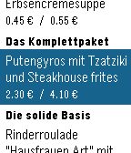
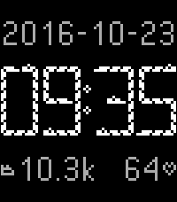

<!-- Generated by scripts/update_app_directory.py: do not edit by hand -->
[← All Pebble Developers](../developers.md)

# Jan Hoffmann

*1 watchface and 1 app · Last updated 2026-10-11 · [About these lists](../about-app-lists.md)*

Links: [Pebble App Store](https://apps.repebble.com/apps/dev/jan-hoffmann_57dafd212d0cc80b6f0000d3) · [Rebble App Store](https://apps.rebble.io/en_US/developer/57dafd212d0cc80b6f0000d3/1) · [GitHub (janh)](https://github.com/janh)

<button type="button" data-filter="all" aria-pressed="true">All 2</button><button type="button" data-filter="watchface" aria-pressed="false">Watchfaces 1</button><button type="button" data-filter="watchapp" aria-pressed="false">Apps 1</button>

<label class="dev-sort">Sort by <select><option value="updated">Recently updated</option><option value="released">Newest release</option><option value="title">A–Z</option></select></label>

<h2 class="app-name" id="app-580525f2c988667eaa00000f"><a href="https://apps.repebble.com/580525f2c988667eaa00000f">Mensa Stuttgart</a> v1.2</h2>
<a class="app-source" href="https://github.com/janh/mensa-stuttgart" title="Source code" data-search-exclude>View source</a>

App

Released 2016-10-17 Updated 2018-06-20

Runs on: Round 2, Time 2, Pebble 2 Duo, Pebble 2, Time Round, Time, Classic

Diese App zeigt jederzeit das aktuelle Essensangebot der Mensen des Studierendenwerks Stuttgart. Das Angebot der kommenden Tage wird gespeichert, sodass der Zugriff auch ohne Internetverbindung…

<h2 class="app-name" id="app-59e4e5870dfc32823d00283b"><a href="https://apps.rebble.io/en_US/application/59e4e5870dfc32823d00283b">Snake</a> v1.0</h2>
<a class="app-source" href="https://github.com/janh/snake-pebble" title="Source code" data-search-exclude>View source</a>

Watchface

Released 2017-10-16 Updated 2017-10-17 Rebble App Store

Runs on: Round 2, Time 2, Pebble 2 Duo, Pebble 2, Time Round, Time, Classic

With this watchface inspired by the classic game, little snakes crawl around on your watch to show you the time. Features: - Different date formats with year or weekday - Shows step count, heart…

