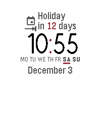

<!-- Generated by scripts/update_app_directory.py: do not edit by hand -->
[← All Pebble Developers](../developers.md)

# Jan Jacobs

*1 watchface · Last updated 2026-10-11 · [About these lists](../about-app-lists.md)*

Links: [Rebble App Store](https://apps.rebble.io/en_US/developer/573ef54158b158b89e000009/1) · [GitHub (jacobsjan)](https://github.com/jacobsjan)

<h2 class="app-name" id="app-57aa228f693f7eb8dd000015"><a href="https://apps.rebble.io/en_US/application/57aa228f693f7eb8dd000015">Alternating Tidbits</a> v2.3</h2>
<a class="app-source" href="http://github.com/jacobsjan/AlternatingTidbits" title="Source code" data-search-exclude>View source</a>

Watchface

No licence Released 2016-08-09 Updated 2017-12-28 Rebble App Store

Runs on: Round 2, Time 2, Pebble 2 Duo, Pebble 2, Time Round, Time, Classic

A calm, elegant and professional watch face boasting lots of features. Displays one tidbit of information at a time, alternating between them every minute. And in case you want to check something…

