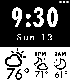
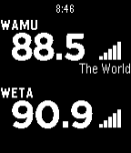

<!-- Generated by scripts/update_app_directory.py: do not edit by hand -->
[← All Pebble Developers](../developers.md)

# Jared Biehler

*2 watchfaces · Last updated 2026-10-11 · [About these lists](../about-app-lists.md)*

Links: [Pebble App Store](https://apps.repebble.com/apps/dev/jared-biehler_531f646301be406e7b0003b4) · [GitHub (jaredbiehler)](https://github.com/jaredbiehler)

<button type="button" data-filter="all" aria-pressed="true">All 2</button><button type="button" data-filter="watchface" aria-pressed="false">Watchfaces 2</button><button type="button" data-filter="watchapp" aria-pressed="false" disabled>Apps 0</button>

<label class="dev-sort">Sort by <select><option value="updated">Recently updated</option><option value="released">Newest release</option><option value="title">A–Z</option></select></label>

<h2 class="app-name" id="app-53630f55ce68f72efc00011f"><a href="https://apps.repebble.com/53630f55ce68f72efc00011f">Weather My Way</a> v1.3</h2>
<a class="app-source" href="https://github.com/jaredbiehler/weather-my-way" title="Source code" data-search-exclude>View source</a>

Watchface

Released 2014-05-02 Updated 2016-03-14

Runs on: Time 2, Pebble 2 Duo, Pebble 2, Time, Classic

Weather Underground current conditions and hourly forecasts* wrapped in a Futura Weather design. - Configurable weather data services (Weather Underground, Open Weather API) - Updates every 15…

<h2 class="app-name" id="app-5382a37b110a591b98000005"><a href="https://apps.repebble.com/5382a37b110a591b98000005">Public Radio Finder</a> v1.0.1</h2>
<a class="app-source" href="https://github.com/jaredbiehler/public-radio-finder" title="Source code" data-search-exclude>View source</a>

Watchface

Released 2014-05-26 Updated 2014-05-27

Runs on: Time 2, Pebble 2 Duo, Pebble 2, Time, Classic

Find a local NPR station no matter where you are. This watchface uses GPS to find and display the NPR stations closest to you. Every 15 minutes, this watchface updates itself with the current…

