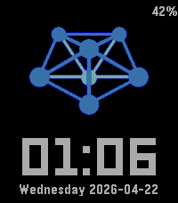

<!-- Generated by scripts/update_app_directory.py: do not edit by hand -->
[← All Pebble Developers](../developers.md)

# Jaron Viëtor

*1 watchface · Last updated 2026-10-11 · [About these lists](../about-app-lists.md)*

Links: [Pebble App Store](https://apps.repebble.com/apps/dev/jaron-vi-tor_136e9e4e9046b20c5e6b2df7) · [GitHub (Thulinma)](https://github.com/Thulinma)

<h2 class="app-name" id="app-f9fe0bbddadd40a9a9836673"><a href="https://apps.repebble.com/f9fe0bbddadd40a9a9836673">MistServer</a> v2.1.0</h2>
<a class="app-source" href="https://github.com/Thulinma/MistServer-Pebble-Watchface" title="Source code" data-search-exclude>View source</a>

Watchface

No licence Released 2026-04-21 Updated 2026-04-24

Runs on: Round 2, Time 2, Pebble 2 Duo, Pebble 2, Time Round, Time, Classic

Watchface for MistServer fans and/or team members (a surprisingly large percentage has Pebbles).

