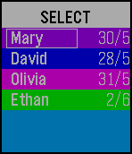

<!-- Generated by scripts/update_app_directory.py: do not edit by hand -->
[← All Pebble Developers](../developers.md)

# jas-b

*1 app · Last updated 2026-10-12 · [About these lists](../about-app-lists.md)*

Links: [Pebble App Store](https://apps.repebble.com/apps/dev/jas-b_52f14431f21676db5c0000f5) · [GitHub (jas-b)](https://github.com/jas-b)

<h2 class="app-name" id="app-556bc45b480902c4b500008b"><a href="https://apps.repebble.com/556bc45b480902c4b500008b">Who&#x27;s Next</a> v1.5</h2>
<a class="app-source" href="http://github.com/jas-b/Whos_Next" title="Source code" data-search-exclude>View source</a>

App

MIT Released 2015-06-01 Updated 2016-01-23

Runs on: Round 2, Time 2, Pebble 2 Duo, Pebble 2, Time Round, Time, Classic

A simple app to keep track of whose turn it is next. Tracks up to six names. Hold down the select button to change modes, press to perform the selected action. SELECT: Moves the selected name to…

