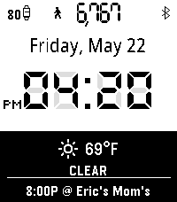
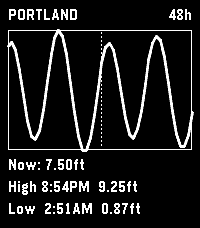

<!-- Generated by scripts/update_app_directory.py: do not edit by hand -->
[← All Pebble Developers](../developers.md)

# jashyotes

*1 watchface and 1 app · Last updated 2026-10-12 · [About these lists](../about-app-lists.md)*

Links: [Pebble App Store](https://apps.repebble.com/apps/dev/jashyotes_ef13c80cb0a9403c1736ae5c) · [GitHub (jashyotes)](https://github.com/jashyotes)

<button type="button" data-filter="all" aria-pressed="true">All 2</button><button type="button" data-filter="watchface" aria-pressed="false">Watchfaces 1</button><button type="button" data-filter="watchapp" aria-pressed="false">Apps 1</button>

<label class="dev-sort">Sort by <select><option value="updated">Recently updated</option><option value="released">Newest release</option><option value="title">A–Z</option></select></label>

<h2 class="app-name" id="app-95e29b8577814a36a22799ef"><a href="https://apps.repebble.com/95e29b8577814a36a22799ef">Pixel Style w. Calendar</a> v1.54</h2>
<a class="app-source" href="https://github.com/jashyotes/simple-pixel-style" title="Source code" data-search-exclude>View source</a>

Watchface

No licence Released 2026-05-08 Updated 2026-09-03

Runs on: Round 2, Time 2

Initial Pebble Time 2 / emery release. - Pixel-watch-style black-and-white watchface structure. - Watch battery, Bluetooth status, date, AM/PM, time, steps, BPM, and reserved weather/rain/event…

<h2 class="app-name" id="app-4cd94d569cf74819a2d66816"><a href="https://apps.repebble.com/4cd94d569cf74819a2d66816">US Tidemaps</a> v0.4.0</h2>
<a class="app-source" href="https://github.com/jashyotes/us-tidemaps" title="Source code" data-search-exclude>View source</a>

App

MIT Released 2026-05-22 Updated 2026-07-16

Runs on: Round 2, Time 2, Time Round

# US Tidemaps Standalone Pebble app showing NOAA tide predictions for a user-configured station. Designed for the Pebble Time 2 (emery). 48-hour hourly window centered on &quot;now&quot; (24 past, 24…

