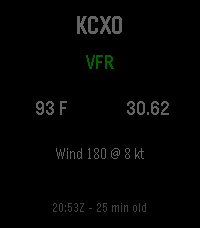
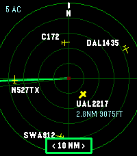

<!-- Generated by scripts/update_app_directory.py: do not edit by hand -->
[← All Pebble Developers](../developers.md)

# Jason Marquette

*2 apps · Last updated 2026-10-12 · [About these lists](../about-app-lists.md)*

Links: [Pebble App Store](https://apps.repebble.com/apps/dev/jason-marquette_5bee80559abfa407b64d6d00) · [GitHub (jasonmarquette)](https://github.com/jasonmarquette)

<button type="button" data-filter="all" aria-pressed="true">All 2</button><button type="button" data-filter="watchface" aria-pressed="false" disabled>Watchfaces 0</button><button type="button" data-filter="watchapp" aria-pressed="false">Apps 2</button>

<label class="dev-sort">Sort by <select><option value="updated">Recently updated</option><option value="released">Newest release</option><option value="title">A–Z</option></select></label>

<h2 class="app-name" id="app-23eaa3d5cc07456fa6c2f03b"><a href="https://apps.repebble.com/23eaa3d5cc07456fa6c2f03b">METAR Aviation Weather</a> v1.2.1</h2>
<a class="app-source" href="https://github.com/jasonmarquette/mini-metar-pebble" title="Source code" data-search-exclude>View source</a>

App

MIT Released 2026-07-17 Updated 2026-07-19

Runs on: Round 2, Time 2, Pebble 2 Duo, Pebble 2, Time, Classic

Mini METAR brings current aviation weather directly to your Pebble smartwatch. View live METAR information for any ICAO airport, including flight category, temperature, wind, altimeter setting…

<h2 class="app-name" id="app-13851ccc1efa4d458b07c060"><a href="https://apps.repebble.com/13851ccc1efa4d458b07c060">ADS-B Radar</a> v1.1.1</h2>
<a class="app-source" href="https://github.com/jasonmarquette/pebble-adsb-radar" title="Source code" data-search-exclude>View source</a>

App · <a href="https://forum.rebble.io/t/1149" title="Discuss this app on the Rebble forum" data-search-exclude>Forum thread</a>

MIT Released 2026-07-13 Updated 2026-07-19

Runs on: Round 2, Time 2

Live nearby aircraft from ADS-B.fi Phone-based GPS location Adjustable 5, 10, 20, or 40 nautical mile radar range 10 NM default range Watch-button range controls

