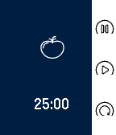

<!-- Generated by scripts/update_app_directory.py: do not edit by hand -->
[← All Pebble Developers](../developers.md)

# Jason Quisberth

*1 app · Last updated 2026-10-11 · [About these lists](../about-app-lists.md)*

Links: [Pebble App Store](https://apps.repebble.com/apps/dev/jason-quisberth_545e680ff17b0f11e400001a) · [GitHub (61quisberth)](https://github.com/61quisberth)

<h2 class="app-name" id="app-5738d37c771f1fc4ed000017"><a href="https://apps.repebble.com/5738d37c771f1fc4ed000017">Pomotime</a> v2.0</h2>
<a class="app-source" href="https://github.com/61quisberth/pomotime" title="Source code" data-search-exclude>View source</a>

App

MIT Released 2016-05-15 Updated 2016-10-31

Runs on: Round 2, Time 2, Pebble 2 Duo, Pebble 2, Time Round, Time, Classic

PomoTime - Tomato-based productivity timer Sleek, simple, and intuitive pomodoro timer for use with Pebble. Spend less time figuring out how to use the app and more time getting things done…

