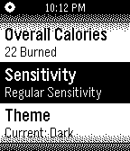

<!-- Generated by scripts/update_app_directory.py: do not edit by hand -->
[← All Pebble Developers](../developers.md)

# Jathusan Thiruchelvanathan

*1 app · Last updated 2026-10-11 · [About these lists](../about-app-lists.md)*

Links: [Pebble App Store](https://apps.repebble.com/apps/dev/jathusan-thiruchelvanathan_52f1363a36bae3f5700001eb) · [GitHub (jathusanT)](https://github.com/jathusanT) · [Website (jathusan.me)](http://www.jathusan.me)

<h2 class="app-name" id="app-5313c2f943d9606d1d0000ef"><a href="https://apps.repebble.com/5313c2f943d9606d1d0000ef">Pedometer</a> v1.5</h2>
<a class="app-source" href="https://github.com/jathusanT/pebble_pedometer" title="Source code" data-search-exclude>View source</a>

App

Released 2014-03-02 Updated 2014-04-05

Runs on: Time 2, Pebble 2 Duo, Pebble 2, Time, Classic

The open-source, stand alone pedometer for the Pebble SmartWatch! NEW in v1.5: - sensitivity settings - improved accuracy - updated ui View your steps, and calories burned throughout your run, and…

