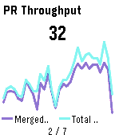

<!-- Generated by scripts/update_app_directory.py: do not edit by hand -->
[← All Pebble Developers](../developers.md)

# Javier Rengel

*1 app · Last updated 2026-10-12 · [About these lists](../about-app-lists.md)*

Links: [Pebble App Store](https://apps.repebble.com/apps/dev/javier-rengel_4050fea4292cac94cd096b9d) · [GitHub (rephus)](https://github.com/rephus) · [Website (lightdash.com)](https://lightdash.com)

<h2 class="app-name" id="app-82c00d2a1a234861a5039b6f"><a href="https://apps.repebble.com/82c00d2a1a234861a5039b6f">Lightdash</a> v0.1</h2>
<a class="app-source" href="https://github.com/rephus/pebble-lightdash-app" title="Source code" data-search-exclude>View source</a>

App

Released 2026-04-17 Updated 2026-04-17

Runs on: Round 2, Time 2, Pebble 2 Duo, Pebble 2, Time Round, Time, Classic

A Pebble watchapp that rotates through your [Lightdash](https://www.lightdash.com/) saved charts. Glance at your BI numbers from your wrist. No phone needed once the tiles load.

