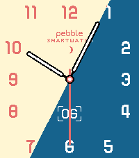
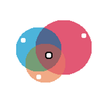
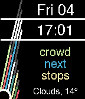

<!-- Generated by scripts/update_app_directory.py: do not edit by hand -->
[← All Pebble Developers](../developers.md)

# Javier Rizzo

*3 watchfaces · Last updated 2026-10-12 · [About these lists](../about-app-lists.md)*

Links: [Rebble App Store](https://apps.rebble.io/en_US/developer/55f51b85eb030e3836000054/1) · [GitHub (JavierRizzoA)](https://github.com/JavierRizzoA) · [Website (javierrizzo.com)](https://javierrizzo.com/)

<button type="button" data-filter="all" aria-pressed="true">All 3</button><button type="button" data-filter="watchface" aria-pressed="false">Watchfaces 3</button><button type="button" data-filter="watchapp" aria-pressed="false" disabled>Apps 0</button>

<label class="dev-sort">Sort by <select><option value="updated">Recently updated</option><option value="released">Newest release</option><option value="title">A–Z</option></select></label>

<h2 class="app-name" id="app-67cdf003b7a023034a3395bc"><a href="https://apps.rebble.io/en_US/application/67cdf003b7a023034a3395bc">Mercury</a> v1.18</h2>
<a class="app-source" href="https://github.com/JavierRizzoA/Pebble-Mercury/" title="Source code" data-search-exclude>View source</a>

Watchface · <a href="https://forum.rebble.io/t/95" title="Discuss this app on the Rebble forum" data-search-exclude>Forum thread</a>

GPL-3.0 Released 2025-03-09 Updated 2026-01-05 Rebble App Store

Runs on: Round 2, Time 2, Pebble 2 Duo, Pebble 2, Time Round, Time, Classic

The background gradient follows the minutes hand. Inspired by the Hermes watchface for the Apple Watch. Fonts provided by NiVZ (check his other cool watchfaces on the store!). This watchface was…

<h2 class="app-name" id="app-67c39775d2acb30009a3c7ac"><a href="https://apps.rebble.io/en_US/application/67c39775d2acb30009a3c7ac">Big Venn</a> v1.1</h2>
<a class="app-source" href="https://github.com/JavierRizzoA/Pebble-BigVenn/" title="Source code" data-search-exclude>View source</a>

Watchface

GPL-3.0 Released 2025-03-01 Updated 2025-03-02 Rebble App Store

Runs on: Round 2, Time 2, Pebble 2 Duo, Pebble 2, Time Round, Time, Classic

Who needs numbers when you can use color and circles? This colorful (in certain platforms :-)) watchface uses three rotating circles to show you the hour, minute and (optionally) seconds. And of…

<h2 class="app-name" id="app-63671421c6c24a000a815e48"><a href="https://apps.rebble.io/en_US/application/63671421c6c24a000a815e48">What 3 Words</a> v1.3</h2>
<a class="app-source" href="https://github.com/JavierRizzoA/Pebble-What3Words" title="Source code" data-search-exclude>View source</a>

Watchface

GPL-3.0 Released 2022-11-06 Updated 2022-11-06 Rebble App Store

Runs on: Time 2, Pebble 2 Duo, Pebble 2, Time, Classic

A watchface that displays your location in What 3 Words format (https://what3words.com/). It also has support for weather if you add an OpenWeatherMap API key. Thanks to /u/arminsson, who…

