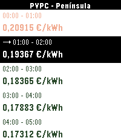

<!-- Generated by scripts/update_app_directory.py: do not edit by hand -->
[← All Pebble Developers](../developers.md)

# Javierorp

*2 apps · Last updated 2026-10-12 · [About these lists](../about-app-lists.md)*

Links: [Pebble App Store](https://apps.repebble.com/apps/dev/javierorp_6abfbc8aaef3d700082ad48f) · [GitHub (javierorp)](https://github.com/javierorp) · [Website (javierorp.vercel.app)](https://javierorp.vercel.app/)

<button type="button" data-filter="all" aria-pressed="true">All 2</button><button type="button" data-filter="watchface" aria-pressed="false" disabled>Watchfaces 0</button><button type="button" data-filter="watchapp" aria-pressed="false">Apps 2</button>

<label class="dev-sort">Sort by <select><option value="updated">Recently updated</option><option value="released">Newest release</option><option value="title">A–Z</option></select></label>

<h2 class="app-name" id="app-6ac8f6b8836dec0008982ccb"><a href="https://apps.repebble.com/6ac8f6b8836dec0008982ccb">AImigo</a> v1.0.0</h2>
<a class="app-source" href="https://github.com/javierorp/pebble-aimigo" title="Source code" data-search-exclude>View source</a>

App · <a href="https://forum.rebble.io/t/1414" title="Discuss this app on the Rebble forum" data-search-exclude>Forum thread</a>

MIT Released 2026-10-09 Updated 2026-10-09

Runs on: Round 2, Time 2, Pebble 2 Duo

Your (small) AI voice assistant, right on your wrist. ⚠️ Requires a NaN.builders API key (https://nan.builders) and the Pebble phone app connected for dictation. Supported watches: ✅ Pebble Time 2…

<h2 class="app-name" id="app-6ac659d64ccfa70009b00593"><a href="https://apps.repebble.com/6ac659d64ccfa70009b00593">Precio Luz PVPC</a> v1.1.0</h2>
<a class="app-source" href="https://github.com/javierorp/pebble-pvpc" title="Source code" data-search-exclude>View source</a>

App · <a href="https://forum.rebble.io/t/1412" title="Discuss this app on the Rebble forum" data-search-exclude>Forum thread</a>

MIT Released 2026-10-07 Updated 2026-10-07

Runs on: Round 2, Time 2, Pebble 2 Duo, Pebble 2, Time Round, Time, Classic

Consulta el precio de la luz (PVPC*) en España desde tu muñeca. - Los 24 precios del día en €/kWh o €/MWh - Precios de mañana en cuanto los publica REE (sobre las 20:00 h) - Hora en vigor marcada…

