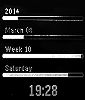

<!-- Generated by scripts/update_app_directory.py: do not edit by hand -->
[← All Pebble Developers](../developers.md)

# jawshuwah

*1 watchface · Last updated 2026-10-12 · [About these lists](../about-app-lists.md)*

Links: [Pebble App Store](https://apps.repebble.com/apps/dev/jawshuwah_52f018a6bb34231cf300026b) · [GitHub (jawshuwah)](https://github.com/jawshuwah)

<h2 class="app-name" id="app-5309dc6bd419b30bfe0002b5"><a href="https://apps.repebble.com/5309dc6bd419b30bfe0002b5">Progress Watch</a> v1.2</h2>
<a class="app-source" href="https://github.com/jawshuwah/progress-watch/tree/alternative" title="Source code" data-search-exclude>View source</a>

Watchface

No licence Released 2014-02-23 Updated 2014-03-14

Runs on: Time 2, Pebble 2 Duo, Pebble 2, Time, Classic

Igorfv&#x27;s progress bar watch, updated to work on the 2.0 firmware. I just found this design particularly nice and it was one of the few things I really missed from before the update. I did this…

