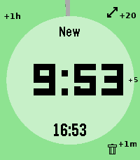
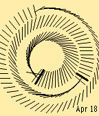

<!-- Generated by scripts/update_app_directory.py: do not edit by hand -->
[← All Pebble Developers](../developers.md)

# jazzabeanie

*1 watchface and 1 app · Last updated 2026-10-11 · [About these lists](../about-app-lists.md)*

Links: [Pebble App Store](https://apps.repebble.com/apps/dev/jazzabeanie_2f99953f4c8baa21eba9b4ef) · [GitHub (jazzabeanie)](https://github.com/jazzabeanie)

<button type="button" data-filter="all" aria-pressed="true">All 2</button><button type="button" data-filter="watchface" aria-pressed="false">Watchfaces 1</button><button type="button" data-filter="watchapp" aria-pressed="false">Apps 1</button>

<label class="dev-sort">Sort by <select><option value="updated">Recently updated</option><option value="released">Newest release</option><option value="title">A–Z</option></select></label>

<h2 class="app-name" id="app-63a5cca9f2e945c092123615"><a href="https://apps.repebble.com/63a5cca9f2e945c092123615">QuickTimer</a> v1.4</h2>
<a class="app-source" href="https://github.com/jazzabeanie/pebble-timer-quick" title="Source code" data-search-exclude>View source</a>

App

Released 2026-04-13 Updated 2026-06-29

Runs on: Round 2, Time 2, Pebble 2 Duo, Pebble 2, Time Round, Time, Classic

# pebble-timer-quick QuickTimer is a timer app for the Pebble Smartwatch, intended to be the fastest way to start a timer or stopwatch. Made for people that think needing 5 seconds to set a…

<h2 class="app-name" id="app-64e3eda4cba941fbaf0be5df"><a href="https://apps.repebble.com/64e3eda4cba941fbaf0be5df">Rotating Lines</a> v1.2</h2>
<a class="app-source" href="https://github.com/jazzabeanie/rotating-lines" title="Source code" data-search-exclude>View source</a>

Watchface

Released 2026-04-18 Updated 2026-04-19

Runs on: Round 2, Time 2, Pebble 2 Duo, Pebble 2, Time Round, Time, Classic

Highly configurable analog style watch with rotating lines instead of hands

