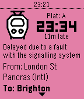

<!-- Generated by scripts/update_app_directory.py: do not edit by hand -->
[← All Pebble Developers](../developers.md)

# jcit

*1 app · Last updated 2026-10-12 · [About these lists](../about-app-lists.md)*

Links: [Pebble App Store](https://apps.repebble.com/apps/dev/jcit_542040a2d6b6c950fa000132) · [GitHub (jccit)](https://github.com/jccit)

<h2 class="app-name" id="app-67a8c311b5e348000915b07b"><a href="https://apps.repebble.com/67a8c311b5e348000915b07b">PebbleRail</a> v0.9</h2>
<a class="app-source" href="https://github.com/jccit/pebblerail" title="Source code" data-search-exclude>View source</a>

App · <a href="https://forum.rebble.io/t/270" title="Discuss this app on the Rebble forum" data-search-exclude>Forum thread</a>

GPL-3.0 Released 2025-02-09 Updated 2025-12-15

Runs on: Round 2, Time 2, Pebble 2 Duo, Pebble 2, Time Round, Time, Classic

View live UK train times from your Pebble! Features: * View departures from nearby stations * See upcoming and previous stops * Pin departure/arrival to the timeline Timeline icons by LCP Powered…

